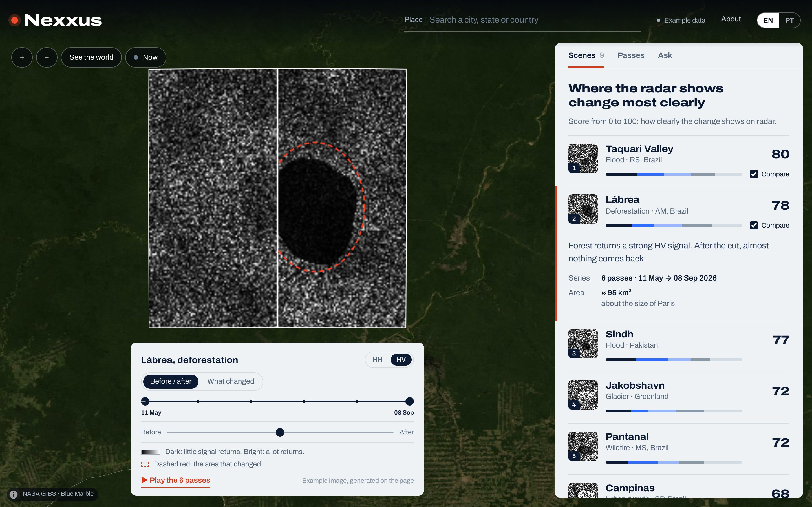
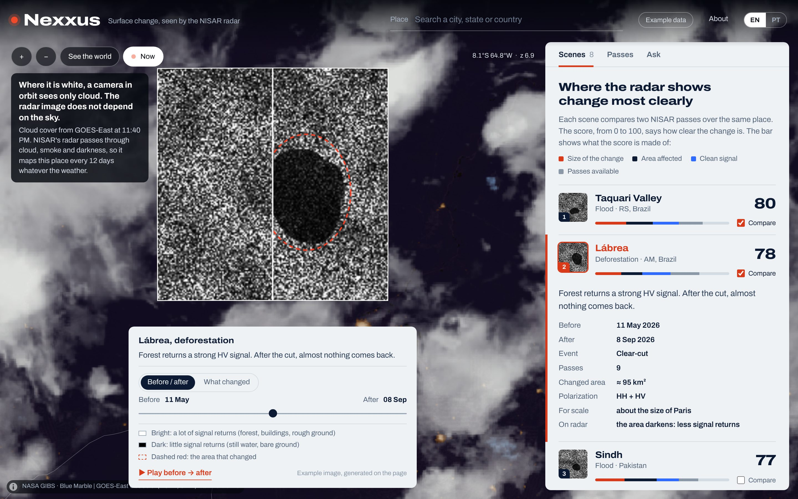
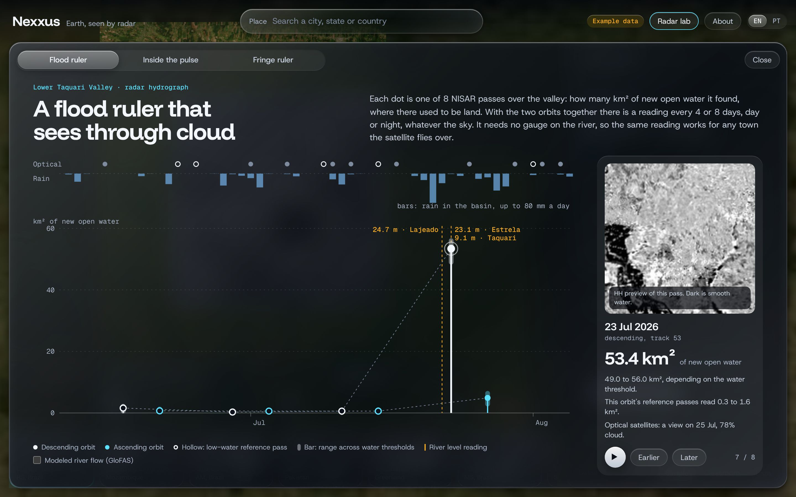

# Nexxus

**See how the Earth's surface changes, through the radar eyes of NASA's NISAR satellite.**

Nexxus is our team's project for the [NASA Space Apps Challenge 2026](https://www.spaceappschallenge.org/) (Campinas, Brazil), built for the *Dancing with the SARs* challenge. It puts radar change detection on a globe anyone can explore: pick a place, compare two satellite passes, and read in plain language what changed and how much.



> **Status:** the interface is complete and runs end to end. Pass lists come from NASA's public catalog and every scene shows a real NISAR before and after pair, calibrated data read straight from the GCOV files on one fixed brightness scale. Two scenes are documented events, with their sources: the July 22, 2026 flood in the Taquari Valley, seen by NISAR the next evening, and the January 2026 Limpopo River flood around Chókwè, Mozambique. The other scenes are described as seasonal changes, with no confirmed event. Scene scores are still placeholders. The app labels example data on screen.

## Why radar

Optical satellites need daylight and a clear sky. Radar needs neither: it sends its own signal and measures what bounces back, through cloud, smoke and darkness. That makes it the right instrument for a flood in the middle of a storm or a forest that is almost always under cloud.

The catch is that a radar image is hard to read. It is grainy, black and white, and brightness means "how much signal came back", not colour. Nexxus exists to close that gap.

## What you can do

| | |
|---|---|
|  |  |
| **Explore the globe.** Each pin is a scene: NISAR passes over the same place, from one season to the next. | **Measure the change.** The change map paints what changed between the two passes you picked and counts the area, live, as you move the sensitivity. |
|  |  |
| **Check any place.** Search a city, state or country to see when NISAR passed, when it passes next, and the swath each orbit images. | **See through the clouds.** The Now button loads the latest cloud cover, and the radar scene shows through it. |
|  |  |
| **Measure a flood pass by pass.** The radar lab turns the NISAR passes over the lower Taquari valley into a flood ruler: new open water in calibrated data, one reading every 4 or 8 days through cloud, about 53 km² on the night after the peak, checked against river level readings, NASA's OPERA water map and the best optical image. | **Go inside the radar.** Drag a ruler over the real interferogram of the June 2026 Venezuela earthquake and count the fringes, each about 12 cm of change in the distance to the satellite, or watch pulse compression pull a buried echo out of the noise. |

- **A series of passes.** Each scene is a series of passes, in HH and HV (today two real NISAR passes per scene). Pick any two on the timeline and drag the divider between them, or press play and watch each pass sweep over the one before. A legend explains what bright and dark mean.
- **HH and HV.** Switch the radar polarization: HH answers to ground, water and walls; HV to leaves and branches, so clear-cuts show best in HV.
- **Our hometown.** One scene is Campinas, where the team lives: the city is the bright patch, and the fields around it change with the crop cycle.
- **Change map.** Computed in your browser from the two images: it smooths the radar grain, compares the passes on a logarithmic scale and reports the changed area in km², with a comparison you can picture ("about the size of Luxembourg").
- **Ranked scenes.** Each scene gets a score for how clearly the change shows. Adjust the weights and the ranking reorders; check up to three scenes to compare them side by side.
- **Passes and next pass.** For any point on Earth: past passes with orbit, track, polarization and product, plus an estimate of the next one from the 12-day repeat cycle.
- **Ask.** An agent answers questions about the scenes in view, streams its answer and cites the scenes it used.
- **Shareable links.** The address follows the screen, so a link opens the same scene, passes, polarization, mode and language.
- **English and Portuguese**, switchable at the top.
- **Works offline.** The globe and the surroundings of every scene ship with the page.

## Run it

Docker is the only requirement.

```bash
docker compose up -d --build
```

Then open http://localhost:8080. The API answers at http://localhost:3000/api.

For development with hot reload:

```bash
docker compose -f docker-compose.dev.yml up
```

Then open http://localhost:5173.

Type checks and tests run in the same container:

```bash
docker compose -f docker-compose.dev.yml run --rm dev npm run typecheck
```

```bash
docker compose -f docker-compose.dev.yml run --rm dev npm test
```

With Node 20 or newer you can also run it directly: `npm install`, then `npm run dev`. On Windows, outside WSL, `npm run dev` does not start the front end (its script sets an environment variable the POSIX way): use Docker.

## Links that open a view

Everything on screen can be addressed:

| Link | Opens |
|---|---|
| `/?scene=labrea` | the Lábrea scene, zoomed in |
| `/?scene=taquari&view=change` | the Taquari Valley flood, as a change map |
| `/?tab=passes&place=-22.9,-47.1,Campinas` | the passes over Campinas |
| `/?scene=sindh&lang=pt` | a scene, in Portuguese |

## How it is built

```
packages/contract   the data contract: types, example data and example generators
apps/api            NestJS API that serves the contract and bridges to the agent
apps/web            React + TypeScript + Vite front end
scripts/            generators for the offline imagery packs, the scene images (calibrated NISAR GCOV crops), the Taquari water series and the La Guaira interferogram
docs/               screenshots and the team's task list (in Portuguese)
```

- **Front end:** React 18, TypeScript, Vite, TanStack Query and MapLibre GL (3D globe). No UI library; plain CSS with design tokens.
- **API:** NestJS. It serves real NISAR passes (NASA CMR catalog) and the scene images in the exact shape the front end expects, so the full pipeline can replace it without touching the screens.
- **Shipping:** Docker and nginx. One command brings everything up.

The front end reads all its data through a single module (`apps/web/src/api`). Pointing it at a real API is two environment variables; connecting a real agent is two more. Copy `.env.example` to `.env` to set them.

[CLAUDE.md](CLAUDE.md) is the working guide for the team (in Portuguese): how to swap example data for real data, how to connect the agent, the design rules and the known pitfalls.

## What is real and what is example

| Part | Today |
|---|---|
| Globe imagery, borders, place search | Real |
| Live cloud cover (Now) | Real, Americas only, needs a connection |
| Orbit geometry (swath direction and width, 12-day repeat) | Real NISAR parameters |
| Change map and area measurement | Real computation, on calibrated GCOV data in every scene |
| Scene places, orbits, dates and passes per orbit | Real, from the NASA catalog |
| Scene descriptions | Taquari Valley (July 22, 2026 flood) and Chókwè (January 2026 Limpopo flood): documented events, with their sources. Others: seasonal change, no confirmed event |
| Scene scores | Example |
| Pass lists | Real, from NASA's CMR catalog; example with a warning if the catalog is down |
| Radar images | Real: calibrated NISAR GCOV data, read straight from the HDF5 files on one fixed scale for both dates and all scenes |
| Agent answers | Example text until an agent is connected |

## Credits

- **Imagery:** NASA GIBS (Blue Marble; GOES-East GeoColor by NOAA and CIRA) and Esri World Imagery for close-up detail.
- **Places and borders:** Natural Earth (public domain) and world-atlas.
- **City search:** Open-Meteo Geocoding API.
- **Type:** Archivo.

This project is not affiliated with or endorsed by NASA.

## Team

Gabriel (front end and integration), Mateus (API and NASA data), Vitor (agent) and Laís (submission, story and demo).

## License

MIT. See [LICENSE](LICENSE).
