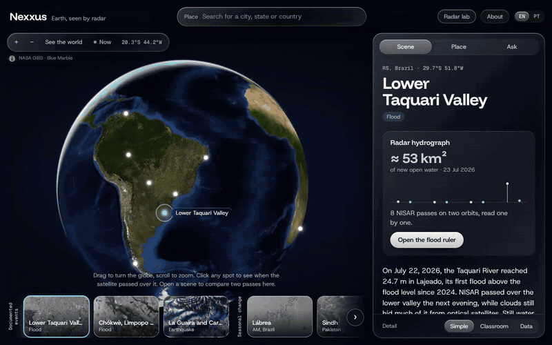
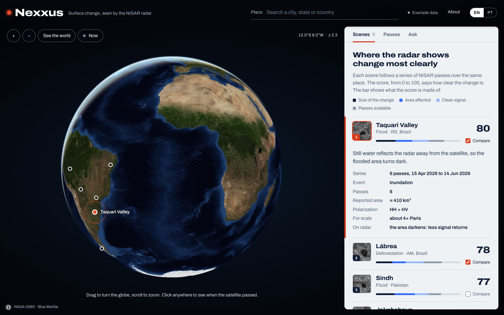
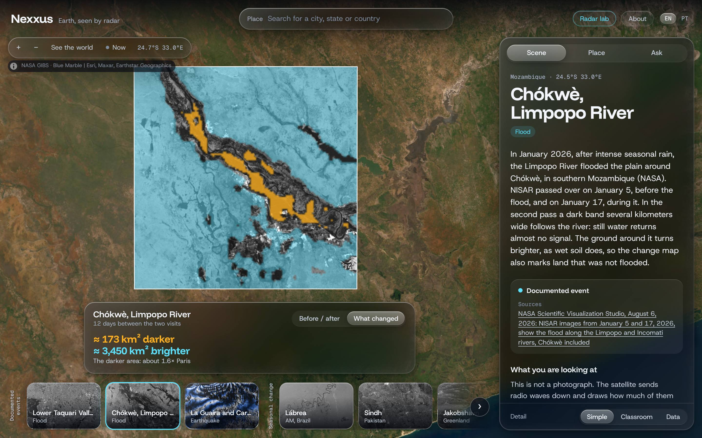
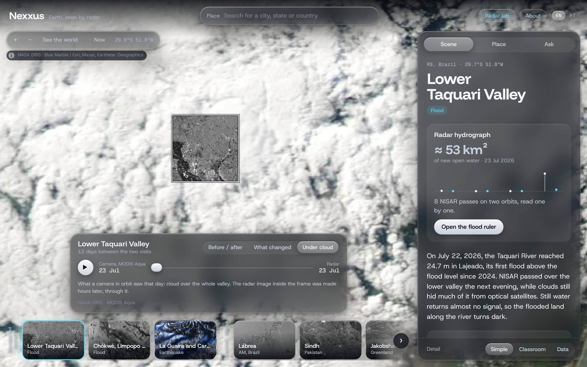
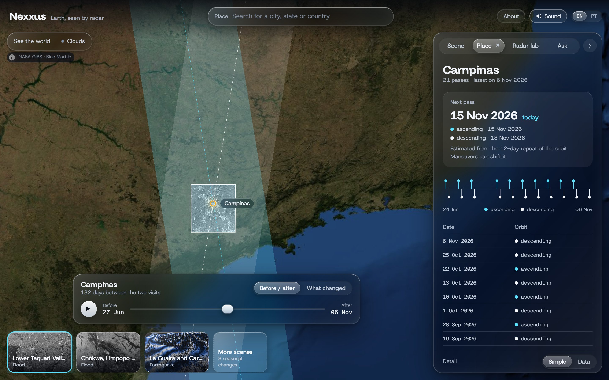
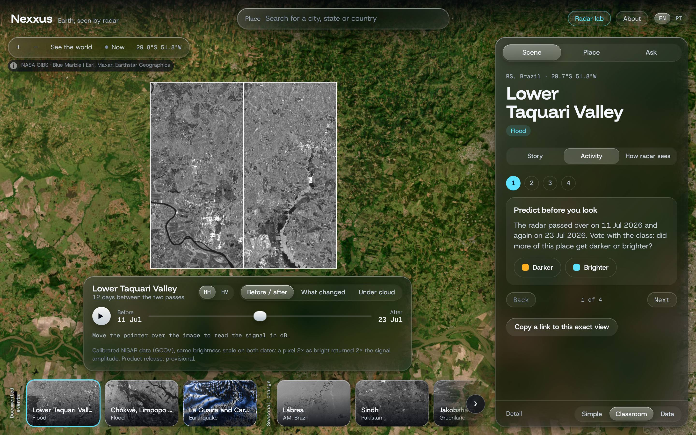
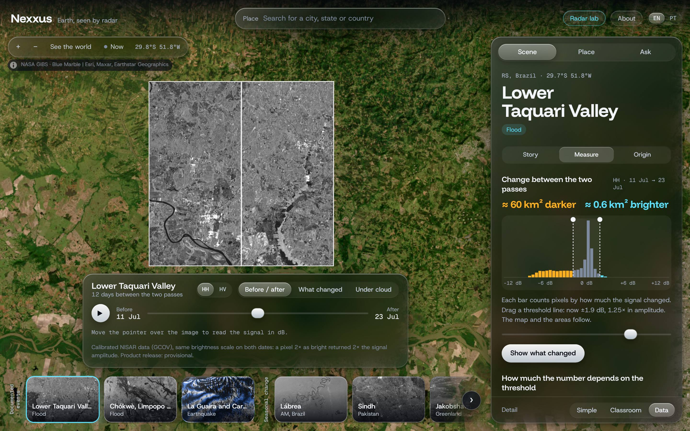
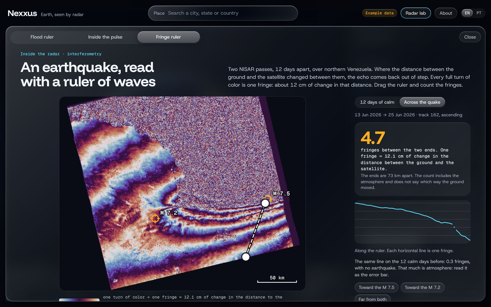
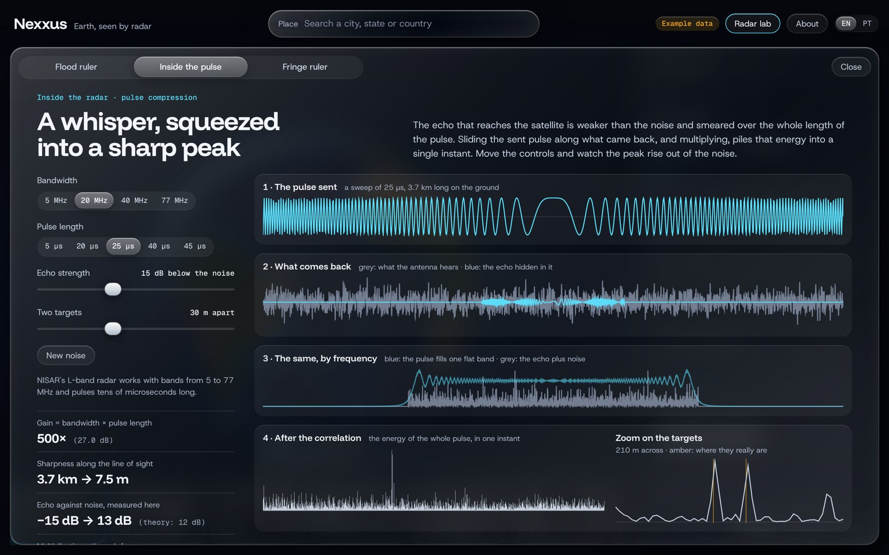
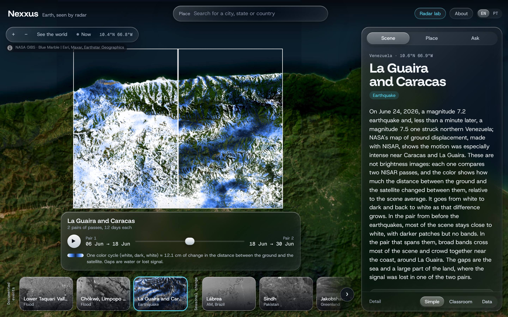

# Nexxus

**See how the Earth's surface changes, through the radar eyes of NASA's NISAR satellite.**

Nexxus puts radar change detection on a globe anyone can explore: pick a place, compare two satellite passes, and read in plain language what changed and how much. It was built for the *Dancing with the SARs* challenge of the [NASA Space Apps Challenge 2026](https://www.spaceappschallenge.org/).

It runs on open NASA data: NISAR radar products from NASA Earthdata (GCOV, the calibrated brightness, and GUNW, the interferograms), the pass list from NASA's CMR catalog and, for context, the OPERA DSWx-S1 water map and MODIS, HLS and VIIRS imagery through GIBS. See [Data provenance](#data-provenance).

**Live demo: [nexxus.earth](https://nexxus.earth)**. Three places to start:

- [The flood under cloud](https://nexxus.earth/?scene=taquari&view=optical): what an optical satellite saw over the Taquari Valley on the day of the radar pass, and the radar scene showing through it.
- [What changed](https://nexxus.earth/?scene=taquari&view=change&steps=2,3): the change map of the same flood, 12 days apart, with the area that got darker in km².
- [The passes over a city](https://nexxus.earth/?tab=passes&place=-22.9,-47.1,Campinas): every NISAR pass over Campinas, from NASA's catalog.



*The lower Taquari Valley, Brazil. The river peaked on July 22, 2026; NISAR passed the next evening. The app compares that pass with earlier ones on the same orbit (the first of the series, 36 days before, in this capture), measures what got darker, and shows what an optical satellite saw that day: cloud.*

## Why radar

Optical satellites need daylight and a clear sky. Radar needs neither: it sends its own signal and measures what bounces back, through cloud, smoke and darkness. That makes it the right instrument for a flood in the middle of a storm or a forest that is almost always under cloud.

The catch is that a radar image is hard to read. It is grainy, black and white, and brightness means "how much signal came back", not colour. Nexxus exists to close that gap.

## Contents

- [Features](#features)
- [Quick start](#quick-start)
- [Architecture](#architecture)
- [API reference](#api-reference)
- [Configuration](#configuration)
- [Deep links](#deep-links)
- [Data provenance](#data-provenance)
- [Regenerating the data](#regenerating-the-data)
- [Use of AI](#use-of-ai)
- [Team](#team)
- [Credits](#credits)
- [License](#license)

## Features

### Explore

| | |
|---|---|
|  |  |
| **A globe of scenes.** Each pin is a place NISAR imaged at least twice. The carousel opens on the three documented events; the eight seasonal changes sit behind the More scenes card. | **Before and after.** Drag the divider between two passes, or press play and watch one sweep over the other. On the timeline you choose which two passes to compare (the Taquari scene has four). HH and HV polarizations are one click apart. |
|  |  |
| **What changed.** The change map paints where the signal fell (amber) and where it rose (ice blue), and reports the area of each side in km², next to something of a familiar size. It is computed in the browser from the two images. | **Under cloud.** The optical image from the day of the event covers the screen, and the radar scene shows through it. |
|  |  |
| **Any place on Earth.** Search a city, state or country, or click any spot on the globe, to list the real NISAR passes over it, the swath of each orbit and an estimate of the next pass. The search can also narrow down from a country to its states and cities. | **Clouds.** One button covers the whole globe with the cloud cover of the latest full day, with the radar scene on top of it. |

### Two levels of detail

Every scene reads at two levels, chosen at the foot of the panel: **Simple** (a short story that ends with a class activity) and **Data** (measurements and provenance). The choice is remembered.

| | |
|---|---|
|  |  |
| **Simple, with a class activity.** The story says what happened, what the scene rests on and how to read the image. The button at its end starts four steps that drive the map: predict whether the place got darker or brighter and check against the measurement, play the before and after, switch HH and HV, and see why it works under cloud. It closes with a short explanation of how radar sees. | **Data.** Three sections: Story, Measure and Origin. Measure has a histogram of the change in dB with a threshold you drag, the area on each side and a table of thresholds, and the map follows. Origin lists the granule and product release of every pass and compares scenes side by side. On the map, the pointer reads the signal in dB on both passes, and a sensitivity control tunes the change map. |

### Radar lab

The Radar lab tab sits between Scene and Ask. It has three tools, each with a short text and its method one click away.

| | |
|---|---|
|  |  |
| **Flood ruler.** New open water measured in each of 8 NISAR passes over the lower Taquari Valley: about 53 km² on the night after the peak, against 0.3 to 1.6 km² on reference passes. Cross-checked with river gauge readings, NASA's OPERA water map and the optical record. Pick a pass on the chart and the map shows it. | **Fringe ruler.** Drag a line over the real interferogram of the June 2026 Venezuela earthquakes and count the fringes, each about 12 cm of change in the distance to the satellite. The default line counts 4.7 fringes across the earthquake and 0.7 on the calm pair before it, shown as the margin of error. |
|  |  |
| **Inside the pulse.** A pulse compression simulation with NISAR's L-band parameters: watch the matched filter pull a buried echo out of the noise. | **Interferogram scene.** Two pairs of passes over La Guaira and Caracas, one before the earthquakes and one across them, shown as phase instead of brightness. |

### Ask

The Ask tab talks to the Mission Guide, an agent that answers only from fact cards the team checked.

- **Grounded answers.** The agent picks the fact cards that match the question, has the language model write from those cards alone, and checks the answer against them: a figure with its unit, a date written in digits or a scene that the cards do not carry fails the check. It checks figures and names, not the prose around them. Without the model (no key, no quota, a slow or rejected answer) it replies with the cards' own sentences, and the screen says so. Outside its subject, it says it does not know and lists what it does.
- **A caveat and the sources with every answer**, attached by the agent's code, not written by the model, plus a button for each scene the answer used.
- **Aware of the open scene.** "What changed here?" is answered about the scene on screen, and the tab suggests questions to start with.
- **Listen.** A button reads the answer and its caveat aloud in the browser's own voice, in the language of the question, with units spelled out. It appears when the browser has a voice for that language.

### Also

- **Sources on screen.** Each scene states what it rests on: a documented event with its sources, or a reading of the images with no confirmed event.
- **English and Portuguese**, switchable at the top.
- **The real sky.** Behind the globe are 15,500 stars from the Hipparcos catalogue, placed where they are behind the Earth at the time of the visit.
- **Soundtrack.** Two public-domain tracks follow the screen, one for exploring and one for the data views. The Sound button turns them off.
- **Room for the map.** The arrow beside the tabs folds the panel into a rail of icons; opening a scene or picking a place brings it back.
- **Works offline.** The globe, the surroundings of every scene, the lab and the place search ship with the app.
- **Shareable links.** The address follows the screen, and the panel has a button that copies a link to the exact view. See [Deep links](#deep-links).
- **Smaller things.** A welcome screen on the first visit (the About button reopens it), a performance panel at `?perf=1`, visible keyboard focus, and animations that follow the system's reduced-motion setting.

## Quick start

Docker is the only requirement.

```bash
docker compose up -d --build
```

Open http://localhost:8080. The API answers at http://localhost:3000/api. The agent has its own test page at http://localhost:8090; its `/api/health` says whether the model is on.

For development with hot reload (front end at http://localhost:5173):

```bash
docker compose -f docker-compose.dev.yml up
```

Type checks and tests run in the same container. The commands install the dependencies first, so they also work on a fresh clone:

```bash
docker compose -f docker-compose.dev.yml run --rm dev sh -c "npm install && npm run typecheck"
```

```bash
docker compose -f docker-compose.dev.yml run --rm dev sh -c "npm install && npm test"
```

With Node 20 or newer you can also run it directly: `npm install`, then `npm run dev`. On Windows, outside WSL, `npm run dev` does not start the front end (its script sets an environment variable the POSIX way): use Docker.

## Architecture

```
packages/contract   the data contract: TypeScript types, fixtures and example generators
apps/api            NestJS API: scenes, real NISAR passes, place search, scene images and the agent bridge
apps/agent          Python + FastAPI agent behind the Ask tab: fact cards, retrieval, prompt, answer check and fallback
apps/web            React + TypeScript + Vite front end
scripts/            data generators: calibrated scene images, water series, interferograms, offline tile packs
docs/               screenshots and the task list (in Portuguese)
```

- **Front end:** React 18, TypeScript (strict), Vite, TanStack Query and MapLibre GL (3D globe). No UI library; plain CSS with design tokens.
- **API:** NestJS. Every route answers in the shape defined in [`packages/contract/src/types.ts`](packages/contract/src/types.ts).
- **Contract first:** the front end reads all its data through one module (`apps/web/src/api`), which talks either to the API (`http`) or to in-browser example data (`mock`). Another backend that honours the contract can replace this API without touching a component.
- **Shipping:** Docker and nginx. One command brings everything up.

[CLAUDE.md](CLAUDE.md) is the contributor guide (in Portuguese): how each part works, the design rules and the known pitfalls.

## API reference

Base URL: `http://localhost:3000/api` (behind the front end's nginx: `/api`). JSON in and out, CORS enabled, no authentication. Routes that return text accept `lang=en|pt` and default to English.

| Method | Route | Returns |
|---|---|---|
| `GET` | [`/health`](#get-health) | Service status and where the data comes from |
| `GET` | [`/scenes`](#get-scenes) | The analyzed scenes, with imagery, sources and measurements |
| `GET` | [`/passes`](#get-passes) | NISAR passes over a point, from NASA's CMR catalog |
| `GET` | [`/places`](#get-places) | Place search: cities, states and countries |
| `POST` | [`/ask`](#post-ask) | An answer from the agent, in one piece |
| `POST` | [`/ask/stream`](#post-askstream) | The same answer, streamed over Server-Sent Events |
| `GET` | [`/scene-images/…`](#get-scene-images) | The radar images of each scene (static PNG) |

### `GET /health`

```json
{ "ok": true, "data": "example", "passes": "nisar", "agent": "connected" }
```

`data` is always `example`: the scene list comes from the fixtures committed in this repository, not from a live catalog query. The images, dates and granules in it are real NISAR products (see [Data provenance](#data-provenance)). `passes` tells where the last pass list came from (`nisar` for the NASA catalog, `example` otherwise); `agent` is `connected` when the API has an agent to call (the default in Docker), `example` otherwise.

### `GET /scenes`

| Parameter | Values | |
|---|---|---|
| `lang` | `en`, `pt` | Language of names, summaries and sources |
| `include` | `interferogram` | Adds the interferogram scene (`laguaira`) at the end of the list |

```bash
curl "http://localhost:3000/api/scenes?lang=en&include=interferogram"
```

Returns a `ScenesResponse`: `{ criteria, scenes }`. A scene, abridged:

```json
{
  "id": "taquari",
  "name": "Lower Taquari Valley",
  "event": "Flood",
  "region": "RS, Brazil",
  "lat": -29.726,
  "lon": -51.812,
  "bbox": [-51.94336, -29.84064, -51.67969, -29.61167],
  "summary": "On July 22, 2026, the Taquari River reached 24.7 m in Lajeado…",
  "change": "darker",
  "polarizations": ["HH", "HV"],
  "acquisitions": [
    {
      "date": "2026-06-17",
      "images": { "HH": "/api/scene-images/taquari/earlier-2026-06-17-HH.png?v=13kow1v", "HV": "…" },
      "granule": "NISAR_L2_PR_GCOV_023_053_D_103_4005_DHDH_A_20260617T213352_…",
      "release": "provisional"
    },
    { "date": "2026-06-29", "images": { "HH": "…", "HV": "…" }, "granule": "…", "release": "provisional" },
    { "date": "2026-07-11", "images": { "HH": "…", "HV": "…" }, "granule": "…", "release": "provisional" },
    { "date": "2026-07-23", "images": { "HH": "…", "HV": "…" }, "granule": "…", "release": "provisional" }
  ],
  "basis": "documented-event",
  "sources": [{ "title": "…", "url": "https://…" }],
  "caveat": "Dark is not always floodwater…",
  "imagery": "gcov",
  "imageryDetails": { "topDb": { "HH": 0, "HV": -6 }, "validPct": 100 }
}
```

| Field | Meaning |
|---|---|
| `bbox` | `[west, south, east, north]`; the images are cropped to it |
| `acquisitions` | The series of passes, oldest first (at least two; four in the Taquari scene, which opens on the first against the last). `images` has one URL per polarization; `granule` and `release` (`beta`, `provisional`, `validated`) identify the NASA product |
| `change` | Direction of the change measured in the calibrated pair |
| `basis` | `documented-event` (the `sources` document it) or `interpretation` (no confirmed event) |
| `imagery` | `gcov` for calibrated backscatter, `gunw` for interferometric phase |
| `imageryDetails` | `topDb`: the dB value of white, per polarization; `validPct`: share of the crop with data |
| `scores`, `facts` | Placeholder scores (flagged `isExample` in `criteria`) and display facts |

Scenes with more data carry optional fields: `waterSeries` and `riverGauge` (new open water per pass and river level readings, Taquari), `floodContext` (rain, modelled discharge, optical record and OPERA water map), `opticalDay` (the optical image of the event day), and, for the interferogram scene, `kind: "interferogram"` and `cycleCm` (centimetres of line-of-sight change per colour cycle).

### `GET /passes`

| Parameter | Values | |
|---|---|---|
| `lat` | −90 to 90 | Required |
| `lon` | −180 to 180 | Required |

```bash
curl "http://localhost:3000/api/passes?lat=-22.9&lon=-47.1"
```

```json
[
  { "date": "2026-11-06", "direction": "descending", "track": 24, "frame": 100, "polarization": "HH + HV", "product": "GCOV" },
  { "date": "2026-10-25", "direction": "descending", "track": 24, "frame": 100, "polarization": "HH + HV", "product": "GCOV" }
]
```

Passes come from NASA's public CMR catalog (the NISAR GCOV collections, no login), newest first, cached for 30 minutes. An empty list means no coverage at that point. If the catalog is unreachable the API answers with generated passes, each flagged `"isExample": true`. Missing or out-of-range coordinates return `400`.

### `GET /places`

| Parameter | Values | |
|---|---|---|
| `q` | text | Name to search. May be empty when `country` is set |
| `kind` | `city`, `state`, `country`, `all` (default) | Type of place |
| `lang` | `en`, `pt` | Language of the names |
| `country` | two-letter ISO code | Restricts the search to a country |
| `admin` | a state's `adminKey` | With `country`, restricts the search to the cities of a state |

```bash
curl "http://localhost:3000/api/places?q=lajeado&kind=city"
```

```json
[
  { "kind": "city", "name": "Lajeado", "admin": "Rio Grande do Sul", "country": "Brazil", "countryCode": "BR", "adminKey": "Rio Grande do Sul", "lat": -29.4669, "lon": -51.9614 }
]
```

The search runs offline over 253 countries and territories, 4,600 states and 226,000 populated places. Only when no city matches does the API fall back to the Open-Meteo geocoder.

### `POST /ask`

```bash
curl -X POST "http://localhost:3000/api/ask" \
  -H "Content-Type: application/json" \
  -d '{"question": "What changed in the Taquari Valley?", "sceneIds": ["taquari"], "lang": "en"}'
```

| Body field | | |
|---|---|---|
| `question` | string | Required |
| `sceneIds` | string[] | Scenes in context: the open one and the ones being compared |
| `history` | `{ role, content }[]` | Earlier turns, oldest first (the last 20 are kept). Accepted for compatibility: the agent answers each question on its own and does not receive them |
| `lang` | `en`, `pt` | |

```json
{
  "answer": "Lower Taquari Valley tells the clearest story among the selected scenes…",
  "citations": [{ "sceneId": "taquari" }],
  "caveats": ["This is new open water, not the total flooded area…"],
  "sources": [{ "title": "NISAR GCOV (NISAR Data User Guide, ASF)", "url": "https://nisar-docs.asf.alaska.edu/gcov/" }],
  "mode": "model"
}
```

The answer comes from the agent in `apps/agent`, which answers only from its own checked fact cards and appends the caveats and sources itself. `mode` is `model` (written by the model and checked), `offline` (sentences taken straight from the fact cards, when there is no key, no quota or the model answer failed the check) or `no_info` (outside what the agent knows). The API forwards `{ question, lang, scene }` (the first of `sceneIds`) and gets `{ answer, caveats, sources, cards, mode }` back. With the agent turned off (`AGENT_URL=off`) the answer is example text with `isExample: true`, and no `caveats`, `sources` or `mode`.

### `POST /ask/stream`

Same body as `POST /ask`. The response is `text/event-stream`; each event is one `data:` line of JSON:

```
data: {"type":"delta","text":"Lower "}

data: {"type":"delta","text":"Taquari "}

data: {"type":"done","response":{"answer":"…","citations":[{"sceneId":"taquari"}],"isExample":true}}
```

The stream ends with `done` (the full response) or `error` (`{ "type": "error", "message": "…" }`). The front end falls back to `POST /ask` when this route is unavailable.

### `GET /scene-images/…`

Static PNGs under `/scene-images/<scene>/`, one grayscale image per pass and polarization, served with open CORS so the browser can read the pixels for the change map. Use the URLs from `GET /scenes`: they carry a version (`?v=`) that changes when an image is regenerated.

## Configuration

Copy `.env.example` to `.env` at the repository root. Docker Compose reads it; after a change, run `docker compose up -d --build` again.

| Variable | Default | Purpose |
|---|---|---|
| `VITE_API_MODE` | `http` | `http` reads from the API; `mock` uses example data in the browser |
| `VITE_API_URL` | `/api` | API address as seen by the browser |
| `GEMINI_API_KEY` | empty | Gemini key for the agent. Empty: the agent answers from its fact cards, without the model |
| `GEMINI_MODEL` | `gemini-3.5-flash-lite` | Model the agent asks. It moves down a queue of models when one is full or gone |
| `AGENT_URL` | empty | Empty: the agent of this repository (`apps/agent`), started by Docker. Another URL: that agent. `off`: the Ask tab answers with example text |
| `AGENT_API_KEY` | empty | Key sent to the agent, if it needs one |
| `PASSES_ONLINE` | `1` | `0` turns off the NASA catalog query and serves example passes |
| `PLACES_ONLINE` | `1` | `0` turns off the online geocoder fallback |
| `PUBLIC_API_URL` | `/api` | Public address of the API, used in the scene image URLs |
| `EARTHDATA_TOKEN` | empty | NASA Earthdata token, used only by the image generation scripts |
| `WEB_PORT` | `8080` | Port of the front end on the host |
| `AGENT_PORT` | `8090` | Port of the agent's own test page on the host |

`VITE_*` variables are compiled into the page: never put a secret in them.

## Deep links

Everything on screen can be addressed:

| Link | Opens |
|---|---|
| `/?scene=taquari` | the Taquari Valley flood, zoomed in |
| `/?scene=taquari&view=change` | the same scene as a change map |
| `/?scene=taquari&view=optical` | the same scene under the day's cloud cover |
| `/?scene=taquari&view=change&steps=2,3` | the change map between two chosen passes (positions in the series, from 0): here July 11 against July 23 |
| `/?scene=labrea&pol=HV` | a scene in HV polarization |
| `/?scene=taquari&aud=analyze` | a scene at the Data level |
| `/?scene=labrea&compare=labrea,sindh&aud=analyze` | a scene with two scenes marked for the side-by-side comparison |
| `/?scene=taquari&tab=ask` | the Ask tab, with the scene as context |
| `/?tab=passes&place=-22.9,-47.1,Campinas` | the passes over Campinas |
| `/?lab=hydro` | the radar lab (`hydro`, `pulse` or `fringes`) |
| `/?scene=sindh&lang=pt` | a scene, in Portuguese |
| `/?perf=1` | the performance panel |

Only what differs from the default goes into the address, and navigating does not add entries to the browser history.

## Data provenance

The app labels example data on screen wherever it appears.

| Part | Status |
|---|---|
| Radar images | Real. Calibrated NISAR GCOV data, read from the HDF5 files on one fixed scale for both dates and all scenes |
| Change map and area measurement | Real computation, in the browser, on the calibrated images |
| Scene places, orbits, dates, granules | Real, from the NASA catalog |
| Documented events | Taquari Valley flood (July 22, 2026), Limpopo flood around Chókwè (January 2026) and the Venezuela earthquakes (June 24, 2026), each with its sources. Other scenes are described as seasonal change, with no confirmed event |
| Taquari water series and river levels | Real. Measured on calibrated data across 8 passes; gauge readings with sources |
| Interferograms | Real. NISAR GUNW products |
| Pass lists | Real, from NASA's CMR catalog; example data with a warning if the catalog is down |
| Globe imagery, borders, place search | Real |
| Cloud cover (Clouds) | Real, whole globe, from the latest full day (not live); needs a connection |
| Rain and discharge in the flood ruler | Reanalysis (ERA5) and model (GloFAS), not measurements at the river |
| Pulse compression | Simulation with NISAR L-band parameters |
| Optical image of the event day (Under cloud) | Real. MODIS Aqua true colour of July 23, 2026, the day of the radar pass. It is there to be seen: it does not measure cloud cover |
| Sky behind the globe | Real star positions, brightness and colour (Hipparcos). The Milky Way glow is an illustration |
| Scene scores | Example. The API still sends them, flagged; they are not shown on screen and only order the scenes in the carousel |
| Agent answers | Real: the agent answers from checked fact cards, with sources. Example text only with the agent turned off |
| Read aloud (Listen) | The browser's built-in speech synthesis; no recording and no server |

## Regenerating the data

Everything the app shows is committed, so none of this is needed to run it. The generators live in `scripts/`; each file's header documents its method, limits and command.

| Script | Produces |
|---|---|
| `gcov_crop.py` | Calibrated scene images from NISAR GCOV files (needs `EARTHDATA_TOKEN`) |
| `scene_images.py` | Orbit, dates and crop of each scene, and browse-image previews |
| `gunw_crop.py`, `insar_fringes.py` | Interferograms for the La Guaira scene and the fringe ruler |
| `water_series.py`, `hydrograph.py` | The Taquari water series and the flood ruler context |
| `optical_day.py` | The optical image of the event day |
| `places_data.py` | The offline place search data |
| `tile-packs.mjs` | The offline globe imagery packs (`npm run tiles`) |
| `sky-stars.mjs` | The star catalogue drawn behind the globe |

## Use of AI

We used AI in two ways, and say so here as the Space Apps rules ask.

**In the product.** The agent behind the Ask tab (`apps/agent`) uses Google Gemini (`gemini-3.5-flash-lite`) to word its answers. The model only sees fact cards written and checked by the team (`apps/agent/data/cards.json`); the agent's code checks each answer against those cards (figures with their units, dates written in digits and scene names; not the prose), falls back to the cards' own sentences when the check fails, and attaches the caveats and sources itself. `apps/agent/data/respostas_prontas.json` holds 112 answers to likely questions, generated by the same model through the same check, so they cost no quota. When the model is not used, the screen says the answer came straight from the cards.

**In development.** We wrote the code with AI coding assistants: mostly Claude Code (Anthropic), and Gemini for read-only passes over the code. They generated and reviewed code, tests and documentation, including this README, under the direction of the team, who reviewed the result and ran it. [CLAUDE.md](CLAUDE.md) is the guide those assistants follow. Commits made this way carry the name of the team member who asked for and reviewed the change; some also carry a `Claude-Session` trailer.

**Not generated by AI.** The radar and optical images are satellite data, and the measurements come from scripts in `scripts/` that read that data. The screenshots are captures of the app. The music is by human composers, in the public domain. The read-aloud voice is the browser's built-in speech synthesis. The project has no AI-generated image, video or music, and does not use the NASA logo.

## Team

Nexxus is a team of four from Campinas, Brazil.

- **Gabriel:** the front end (`apps/web`) and its integration with the API.
- **Mateus:** the API (`apps/api`) and the scripts that turn NASA data into the images and measurements (`scripts/`).
- **Vitor:** the agent behind the Ask tab (`apps/agent`): fact cards, prompt and answer quality.
- **Laís:** submission, story and demo.

## Credits

- **Radar data:** NISAR (NASA and ISRO), via NASA Earthdata and the CMR catalog. OPERA DSWx-S1 water maps by NASA JPL.
- **Imagery:** NASA GIBS (Blue Marble, MODIS Aqua, HLS) and Esri World Imagery for close-up detail.
- **Cloud cover:** VIIRS Corrected Reflectance (True Color) from the NOAA-20 satellite (NOAA and NASA), via NASA GIBS.
- **Places and borders:** [GeoNames](https://www.geonames.org/) (CC BY 4.0), Natural Earth (public domain) and world-atlas; Open-Meteo Geocoding API as online fallback.
- **Sky behind the globe:** star positions, brightness and colour from the Hipparcos catalogue (ESA), as packaged in [d3-celestial](https://github.com/ofrohn/d3-celestial) by Olaf Frohn (BSD 3-Clause). The stars are placed where they are in the sky at the time of the visit. The Milky Way glow is an illustration drawn along the real galactic plane, not a brightness measurement.
- **Rain and discharge:** ERA5 and GloFAS, via Open-Meteo.
- **Earthquake data:** USGS.
- **Music:** [Exploration Theme](https://opengameart.org/content/exploration-theme) by Cleyton Kauffman and [Cosmic Navigation](https://opengameart.org/content/cosmic-navigation) by Synth-thetic, both public domain (CC0), from OpenGameArt.
- **Agent model:** Google Gemini.
- **Type:** Funnel Display, Host Grotesk and Geist Mono (SIL Open Font License 1.1), packaged by Fontsource.

This project is not affiliated with or endorsed by NASA.

## License

MIT. See [LICENSE](LICENSE).
